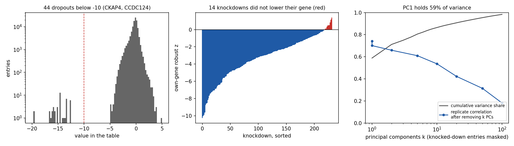
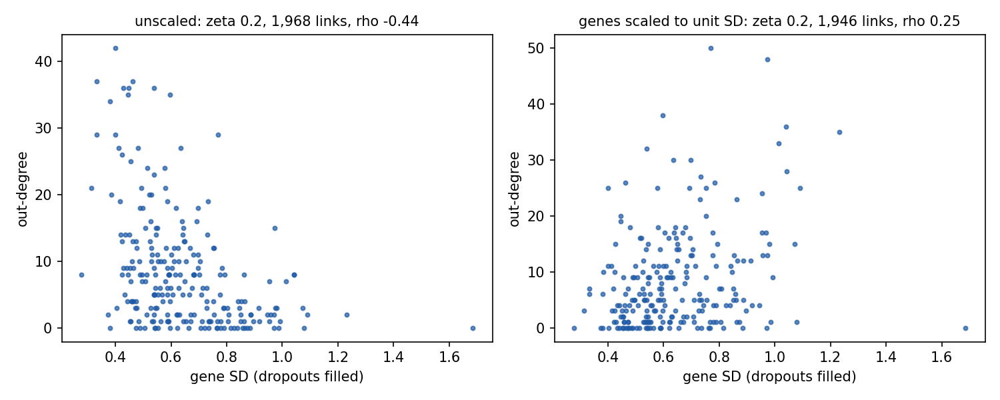
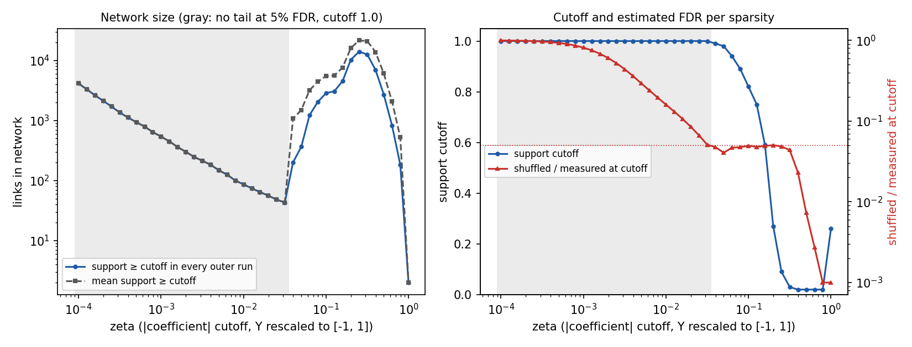
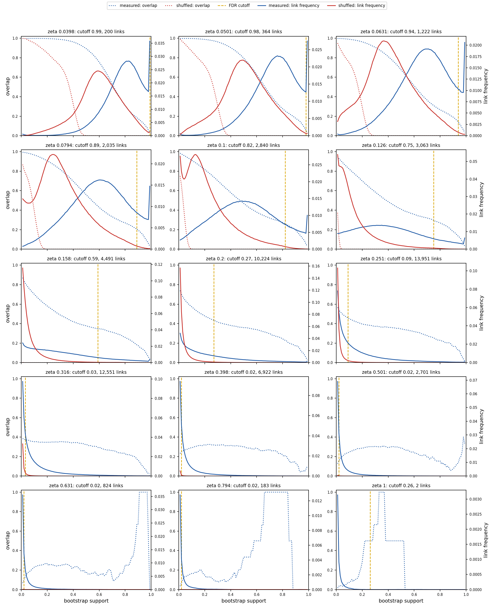
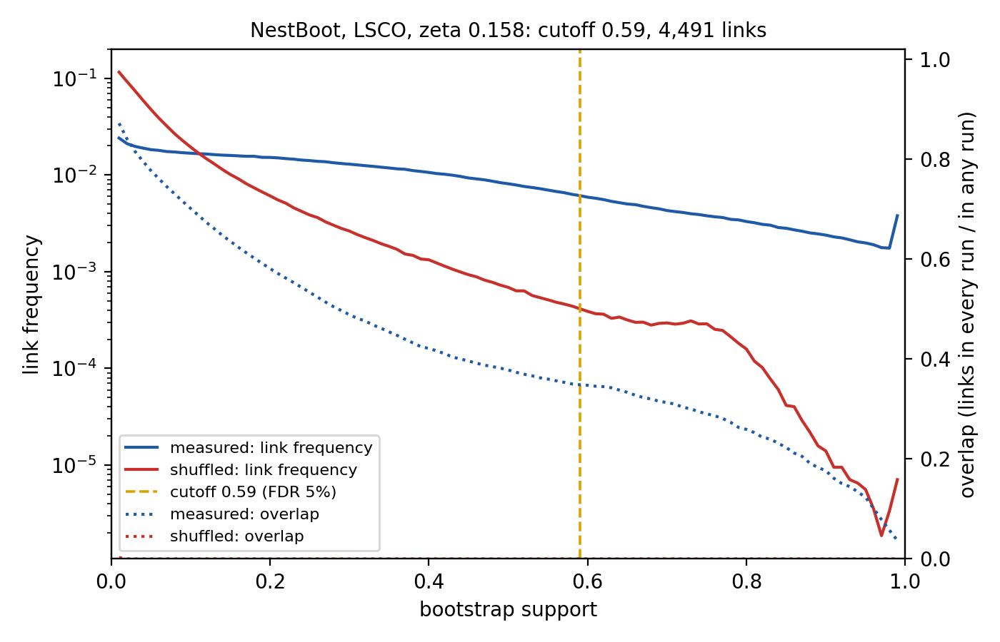

# NestBoot on 232 ENCODE K562 RNA-binding-protein knockdowns

Revised 27 Oct 2026. Replaces the first report on the 12:37 100 × 100 run, whose knockdown signs, dropouts and failed knockdowns were uncorrected. All runs are complete.

## Summary

- **Analysis.** NestBoot (Morgan et al., 2019) with LSCO on the ENCODE K562 table, with P built from the column names. Each outer run fits bootstraps of Y and of a gene-shuffled Y. The shuffled fits set the support cutoff at 5% FDR, and the final A keeps the links at or above that cutoff in every outer run.
- **FDR-controlled networks at 100 × 100.** 15 of 41 sparsities reach 5% FDR, from zeta 0.04 to 1. Fourteen have at least 50 links, from 200 links at zeta 0.04 (cutoff 0.99) to 13,951 at zeta 0.25 (cutoff 0.09). Below zeta 0.04 no sparsity is FDR-controlled.
- **At 3–5 links per gene, the network to use is zeta 0.063.** It has 1,222 links (5.3 per gene), each in at least 94 of 100 bootstraps in every outer run, with an estimated FDR of 4.7% at the cutoff. Nearly every gene has regulators and targets. The other network at that density, zeta 0.631, rests on a few low-variance hubs and links seen in about 1 in 7 bootstraps (section 4.2).
- **The 100 × 100 networks contain the 10 × 10 ones.** At every sparsity that is FDR-controlled in both, every 10 × 10 link is in the 100 × 100 network. For networks of at least 50 links, the 100 × 100 network is 4 to 9 times larger.
- **Hubs** are SF3B1, SNRNP200, SFPQ, PAPOLA and HNRNPU in most networks. Out-degree tracks low gene SD (Spearman −0.16 to −0.47 at 100 × 100). At 10 × 10, dividing each gene by its SD reverses the trend and replaces the hubs with EIF3A, SERBP1 and HNRNPC.
- **Four data problems are fixed in pyGS:**
  - Knockdowns are now coded P = −1, so the fitted diagonal is negative (230 of 232 genes) and link signs read correctly.
  - 44 dropout values (42 in CKAP4, 2 in CCDC124) are filled from replicates. This also removes the offset that the [−1, 1] rescale added to every value.
  - 14 knockdowns that did not lower their own gene, including HNRNPU and DKC1, are removed.
  - The sparsity grid has 41 steps from 10⁻⁴ to 1.
- **At 10 × 10, network size is stable across seeds but link identity is not.** Sizes agree within about 5%, but only 34–53% of links are shared by three seeds.

## 1. Data

| | |
|---|---|
| Input | ENCODE K562 knockdowns from the GeneSnake reproduction repository, [`figure_4/encode_data/ENCODE/ymatrix_k562.csv`](https://bitbucket.org/sonnhammergrni/genesnake_publication_reproduction/raw/e43daafc97608925acd17225d473aaa080c29798/figure_4/encode_data/ENCODE/ymatrix_k562.csv) at commit `e43daafc`, cached as `.gs_cache/downloads/134c84bebbd65203.csv` (sha256 `6976e1d1…`). P is built from the column names |
| Size | 232 genes × 464 samples, values like log fold changes (median −0.18) |
| Design | One knockdown per sample, 2 replicates per gene |
| Knockdown strength | Own-gene robust z (gene's mean in its knockdowns against its median and MAD elsewhere): median −2.92 |
| Replicate agreement | Median correlation of replicate profiles 0.73 with the knocked-down gene left out |



**Figure 1.** Left: all values in the table; the 44 values below −10 are separated from the rest (minimum −5.0) by a gap. Middle: knockdown strength per knockdown; red bars did not lower their own gene. Right: cumulative variance share of principal components, with each sample's knocked-down gene masked, and the replicate correlation left after removing the top k components.

### 1.1 Problems and how they are handled

| Problem | Evidence | Handling (`pygs nestboot` option) |
|---|---|---|
| Knockdown sign | Knockdowns were coded P = +1 although the gene falls; the LSCO diagonal was positive for 227 of 232 genes, the reverse of GeneSPIDER's model Y = −A⁻¹P | Loader codes knockdowns −1 for every method; diagonal now negative for 230 of 232 |
| Dropouts | 44 values from −12.5 to −19.6, all others ≥ −5.0; 42 in CKAP4 across 39 knockdowns (in one replicate for 36 of them), 2 in CCDC124. Never in the gene's own knockdown | `--dropout-below -10`: replaced by the mean of the other replicate, or the gene's median when both replicates are dropouts |
| Rescale offset | The [−1, 1] rescale of `lsco.m` set its minimum from the dropouts, mapping Y = 0 to 0.61 | Gone after filling: Y spans −4.98 to 4.79 and 0 maps to 0.02 |
| Failed knockdowns | 14 knockdowns with own-gene z > 0: AGO2, AKAP8, AQR, CKAP4, DKC1, EIF3G, FUBP3, HNRNPU, PES1, PKM, PRPF8, TAF15, TBRG4, YBX3. With them kept, LSCO explains the missing drop through other genes: DKC1 was the top target in the first report | `--max-knockdown-z 0`: their 28 samples are removed. The genes stay in the network as regulators but receive no links |
| Shared structure | PC1 59% of variance, top 5 80%, top 20 91%; replicate correlation 0.61 after removing 5 components, 0.31 after 50 | None; NestBoot is run on the data as measured |
| Gene variance | Out-degree anti-correlated with gene SD | `--scale-genes` divides each gene by its SD; it changes the hubs (section 3.2), so it is reported as a sensitivity analysis |

## 2. Methods

### 2.1 NestBoot as run

`pygs nestboot` follows GeneSPIDER's `Methods.NestBoot` (Morgan et al., *Bioinformatics* 35:1026, 2019), including `NB_FDR`, `FDRcutoff` and `lsco.m`. The cutoff code matches a line-by-line translation of the MATLAB on 3,000 random cases.

1. Each of R outer runs fits Q bootstraps of the measured data. It also makes one shuffled copy, permuting each sample's values across genes, and fits Q bootstraps of that copy.
2. Bootstraps resample samples within each knockdown's replicates. GeneSPIDER redraws until P has full rank, which never happens with 2 replicates.
3. LSCO: A = −P · pinv(Y), with Y rescaled to [−1, 1] over the whole matrix as in `lsco.m`. A link j → i (row i target, column j regulator) is present when |A<sub>ij</sub>| > zeta. Self-links are excluded; GeneSPIDER includes them.
4. A link's support is the fraction of an outer run's Q fits that contain it. Supports from all outer runs are pooled into R bins. Each tail whose shuffled trapezoid area is at most 5% of the measured area moves the cutoff down one bin (Equation 1 of the paper). When no tail passes, the cutoff is 1.0 and the sparsity is not FDR-controlled. In practice the cutoff stops at the second bin (0.2 at 10 × 10, 0.02 at 100 × 100): the tail starting at the first bin covers every link on both sides, so its ratio is near 1.
5. The network keeps links whose support reaches the cutoff in every outer run. Links whose mean support over outer runs reaches it are saved too.

### 2.2 Runs

All runs use LSCO, FDR 5% and zeta = logspace(−4, 0, 41). The 10 × 10 set (`run_10x10.sh`) covers each preprocessing option (none; dropouts filled; plus failed knockdowns removed; plus gene scaling) and seeds 42, 1 and 2 of the chosen configuration. The 100 × 100 run (`run_100x100.sh`, seed 42) uses dropouts filled and failed knockdowns removed, without gene scaling.

## 3. Results at 10 × 10

### 3.1 Preprocessing

| Preprocessing | FDR-controlled networks (≥ 50 links) | zeta | Links | Spearman (out-degree, gene SD) | Links into failed-knockdown genes | Top regulators (largest network) |
|---|---:|---|---|---|---:|---|
| None | 6 | 0.32–1.0 | 726–5,719 | −0.47 to −0.43 | up to 388 | HNRNPU, SFPQ, PAPOLA, SF3B1, SNRNP200 |
| Dropouts filled | 7 | 0.13–0.50 | 247–4,671 | −0.47 to −0.34 | up to 331 | HNRNPU, PAPOLA, SFPQ, NUFIP2, SF3B1 |
| + failed knockdowns removed | 7 | 0.16–0.63 | 101–3,766 | −0.47 to −0.35 | 0 | PAPOLA, SF3B1, SFPQ, HNRNPU, U2AF2 |
| + genes scaled | 6 | 0.16–0.50 | 127–2,232 | +0.19 to +0.29 | 0 | EIF3A, SERBP1, ILF2, HNRNPC, HNRNPA1 |

Filling the dropouts shifts the FDR-controlled range to smaller zeta, because the rescale no longer compresses the data. HNRNPU remains a top regulator after its knockdown is removed: its column of A comes from its expression across all samples, not from its own knockdown. With failed knockdowns removed, two more sparsities are FDR-controlled but small: 12 links at zeta 0.79 and 1 at zeta 1.

### 3.2 Hub genes



**Figure 2.** Out-degree against gene SD for the 10 × 10 FDR-controlled network closest to 2,000 links, without and with gene scaling (failed knockdowns removed).

LSCO coefficients scale inversely with the regulator's spread, since pinv(D⁻¹Y) = pinv(Y)·D. With an absolute zeta, low-variance genes such as PAPOLA, RCC2 and U2AF2 get large coefficients and many out-links. The gene shuffle mixes all genes' values, so the null has no low-variance genes to match. Scaling genes to unit SD removes this effect and produces a different set of hubs. Neither set should be presented as a biological finding without independent support.

### 3.3 Run-to-run variation

| zeta | Cutoff (seeds 42, 1, 2) | Links (seeds 42, 1, 2) | Links in all three / in any |
|---:|---|---|---:|
| 0.158 | 0.9, 0.9, 0.9 | 490, 464, 466 | 0.34 |
| 0.200 | 0.6, 0.6, 0.6 | 1,968, 1,896, 1,921 | 0.49 |
| 0.251 | 0.3, 0.3, 0.3 | 3,766, 3,745, 3,775 | 0.53 |
| 0.316 | 0.2, 0.2, 0.2 | 2,894, 2,920, 2,933 | 0.52 |
| 0.398 | 0.2, 0.2, 0.2 | 1,149, 1,189, 1,202 | 0.49 |
| 0.501 | 0.2, 0.2, 0.2 | 403, 398, 402 | 0.48 |

## 4. Results at 100 × 100

| zeta | Cutoff | Shuffled / measured at cutoff | Links (every outer run) | Links (mean support) | Top regulators (out-degree) | 10 × 10 links (seed 42), all contained |
|---:|---:|---:|---:|---:|---|---:|
| 0.040 | 0.99 | 0.047 | 200 | 1,068 | CELF1, LIN28B, RCC2, SF3B1 (5 each) | not FDR-controlled |
| 0.050 | 0.98 | 0.041 | 364 | 1,491 | SF3B1 11, SNRNP200 9, CELF1 7 | not FDR-controlled |
| 0.063 | 0.94 | 0.047 | 1,222 | 3,181 | SNRNP200 23, SF3B1 21, RCC2 19 | not FDR-controlled |
| 0.079 | 0.89 | 0.047 | 2,035 | 4,415 | SNRNP200 34, SF3B1 31, FUS 30 | not FDR-controlled |
| 0.100 | 0.82 | 0.049 | 2,840 | 5,475 | SF3B1 43, SNRNP200 40, FUS 39 | not FDR-controlled |
| 0.126 | 0.75 | 0.048 | 3,063 | 5,591 | SF3B1 48, SNRNP200 46, U2AF2 44 | not FDR-controlled |
| 0.158 | 0.59 | 0.049 | 4,491 | 7,560 | SFPQ 69, PAPOLA 67, HNRNPU 66 | 490 |
| 0.200 | 0.27 | 0.050 | 10,224 | 15,970 | HNRNPU 159, PAPOLA 147, SF3B1 147 | 1,968 |
| 0.251 | 0.09 | 0.048 | 13,951 | 21,422 | HNRNPU 198, PAPOLA 189, SF3B1 187 | 3,766 |
| 0.316 | 0.03 | 0.044 | 12,551 | 20,945 | HNRNPU 198, PAPOLA 187, SF3B1 187 | 2,894 |
| 0.398 | 0.02 | 0.023 | 6,922 | 13,739 | HNRNPU 165, PAPOLA 147, SF3B1 146 | 1,149 |
| 0.501 | 0.02 | 0.007 | 2,701 | 6,033 | HNRNPU 107, PAPOLA 92, SF3B1 85 | 403 |
| 0.631 | 0.02 | 0.003 | 824 | 2,072 | HNRNPU 46, SF3B1 43, SFPQ 43 | 101 |
| 0.794 | 0.02 | 0.000 | 183 | 525 | HNRNPU 22, SF3B1 16, SFPQ 16 | 12 |
| 1.000 | 0.26 | 0.000 | 2 | 2 | ESF1, FKBP4 | 1 |

FDR-controlled sparsities at 100 × 100 (`real_100x100_summary.tsv`). Below zeta 0.04 no tail reaches 5% FDR and the cutoff stays at 1.0; those networks (43 to 4,131 links) are not FDR-controlled. No link points into a failed-knockdown gene.



**Figure 3.** Left: links per sparsity, with support at or above the cutoff in every outer run (solid) or on average over outer runs (dashed). Gray bands: sparsities without a tail at 5% FDR. Right: support cutoff and the shuffled-to-measured ratio at the cutoff, with the 5% line.



**Figure 4. Bootstrap support of measured and shuffled links at each FDR-controlled sparsity (ENCODE K562, LSCO, NestBoot 100 × 100).** Each panel is one sparsity zeta, the threshold on |A| with Y rescaled to [−1, 1]; its title gives zeta, the support cutoff and the number of links in the final network. x-axis: bootstrap support, the fraction of the 100 inner bootstraps of an outer run whose fit contains the link. Left axis (solid, log scale): link frequency, the fraction of the 53,592 gene pairs in each support bin, pooled over the 100 outer runs, for the measured data (blue) and the gene-shuffled data (red); support 0 is not drawn. Right axis (dotted): overlap, the number of links at or above that support in all 100 outer runs divided by the number in at least one. Dashed line: the support cutoff, the lowest support at which the shuffled tail area is at most 5% of the measured tail area (Equation 1 of Morgan et al., 2019). The final network keeps the links at or above the cutoff in every outer run. Each outer run draws a new shuffle, so the shuffled overlap is near 0 by construction.



**Figure 5.** Zeta 0.158 in the layout of Fig. 2 of Morgan et al. (2019). Left axis: link frequency, the fraction of all gene pairs whose support in an outer run falls in each bin (support 0 not drawn). Right axis: overlap, the links at or above a support in every outer run divided by those in any outer run. The cutoff (0.59) is where the shuffled tail area falls to 5% of the measured tail area. Measured links outnumber shuffled links from support 0.12 upward; in the top bin, 203 measured against 0.4 shuffled links per outer run. Of the measured links at or above the cutoff in any outer run, 35% are above it in every outer run. Each outer run draws a new shuffle, so the shuffled overlap is near 0 by construction. `make_figures.py --zeta` redraws it for another sparsity.

**Interpreting Figure 5.** Shuffling permutes each sample's values across genes. This keeps the dataset's size, each sample's values and the knockdown design, but destroys the relationships between genes, so the shuffled data are a proper null hypothesis for the measured data. Both go through the same NestBoot process, and Figure 5 overlays their bootstrap support at one sparsity, zeta 0.158. Shuffled links collect at low support: 29% of all gene pairs are in fewer than 1% of the shuffled bootstraps, against 10% for the measured data. Measured links outnumber shuffled links from support 0.12 upward, and the gap widens with support, from 2.5 times at 0.2 to 12 times at 0.5 and 170 times at 0.9. In the top bin, 203 measured links per outer run face 0.4 shuffled ones. Both curves come from the same inference on data of the same shape, so the shuffled curve estimates how many of the measured links at each support level are false. The ratio of the two tails is therefore the FDR at each candidate threshold, and the cutoff is placed where the shuffled tail falls to 5% of the measured tail: support 0.59, at 4.9%. About 7,900 measured links per outer run reach that support, against 380 shuffled ones. The overlap curve adds a stricter requirement, that a link reach the cutoff in every outer run. Of the measured links at or above the cutoff in any outer run, 35% do so in all of them, which gives the final network of 4,491 links. The cutoff is thus not chosen by hand. It is read off the comparison of the two parallel processes, and every included link comes with an estimate of how often a link of that support arises by chance.

- **More sparsities are FDR-controlled than at 10 × 10**, from zeta 0.04 rather than 0.16. Two things change with size: support is measured in steps of 0.01 instead of 0.1, and the tail is pooled over 100 outer runs instead of 10.
- **The largest network is dense.** 13,951 links at zeta 0.25 is 26% of the 53,592 possible links between 232 genes; each link appears in at least 9% of bootstraps in every outer run.
- **The 10 × 10 networks are subsets.** All 490 to 3,766 links of the seed-42 10 × 10 networks, and all links shared by its three seeds, are in the 100 × 100 network at the same zeta.
- **The hubs match the 10 × 10 runs.** SF3B1 and SNRNP200 lead from zeta 0.05 to 0.13; HNRNPU, PAPOLA, SF3B1 and SFPQ lead from zeta 0.16. Spearman between out-degree and gene SD is −0.16 and −0.25 at zeta 0.04 and 0.05, and −0.36 to −0.47 from zeta 0.06 to 0.79.

### 4.1 Trends across sparsity (Figure 4)

As zeta grows, the panels pass through three regimes.

- **Small zeta, 0.04 to 0.08 (first row and the start of the second).** Nearly every gene pair passes the threshold in some bootstrap, 94% in both the measured and the shuffled data. Shuffled links sit at middling support, while measured links pile up at the top: at zeta 0.04, 1,921 measured against 71 shuffled links per outer run reach support 0.99. Because some shuffled links still reach high support, the cutoff stays between 0.89 and 0.99. The networks are small (200 to 2,035 links), and every link is in nearly all bootstraps.
- **Middle zeta, 0.1 to 0.25.** The shuffled distribution collapses toward support 0: at zeta 0.2, 53% of shuffled gene pairs never pass the threshold, against 16% of measured pairs. Measured links keep a long tail to high support. The support at which measured links overtake shuffled ones moves down from 0.33 at zeta 0.1 to 0.02 at zeta 0.25. The cutoff follows it from 0.82 to 0.09, and the network grows to its largest, 13,951 links at zeta 0.25 (60 per gene).
- **Large zeta, 0.32 to 0.79.** Few coefficients pass at all, and shuffled ones almost never do. The cutoff is 0.03 at zeta 0.32 and sits at its floor of 0.02 from zeta 0.4, where the shuffled-to-measured ratio at the cutoff is 2.3%, falling to 0.02% at zeta 0.79. From zeta 0.4 the FDR no longer limits the network: it shrinks from 6,922 to 183 links only because fewer measured coefficients exceed zeta. These links have large coefficients but appear in a minority of bootstraps: at zeta 0.63 the median link is in 14% of them.
- **Zeta 1** keeps 2 links.

The overlap curves show how much the every-outer-run rule removes. Measured overlap at the cutoff rises from 0.03 at zeta 0.04 to 0.46 at zeta 0.25, then falls to 0.07 at zeta 0.79. At zeta 0.04 a link must reach support 0.99 in all 100 outer runs, and only 3% of the links that reach it in some run do so in all. That is why the network kept in every run (200 links) is a fifth of the network by mean support (1,068).

Takeaways:

- **The FDR does not pick the network; zeta does.** The 5% FDR is met at every sparsity from zeta 0.04 to 1, but the networks it admits range from 200 links at support 0.99 to 13,951 links at support 0.09.
- **The most reproducible links come from small zeta.** They pass a small coefficient threshold in nearly every bootstrap of every outer run.
- **At large zeta the estimate is far below 5%, and the network is set by zeta and the 0.02 floor.** The shuffled data rarely produce large coefficients, so the cutoff drops as far as it can, and every link seen in at least 2 of 100 bootstraps in every outer run is kept.

### 4.2 Networks at 3–5 links per gene

3–5 links per gene is 696 to 1,160 links. No FDR-controlled sparsity lands exactly in this range: the grid steps from 364 links at zeta 0.05 (1.6 per gene) to 1,222 at zeta 0.063 (5.3 per gene). The two nearest networks sit on opposite sides of the size peak, and they are different networks.

| | zeta 0.063 | zeta 0.631 |
|---|---|---|
| Links (per gene) | 1,222 (5.3) | 824 (3.6) |
| Support cutoff | 0.94 | 0.02 (floor) |
| Shuffled / measured at cutoff | 4.7% | 0.27% |
| Median mean support of kept links | 0.99 | 0.14 |
| Regulators / targets (of 218 possible) | 213 / 211 | 101 / 169 |
| Median out-degree / in-degree (genes with links) | 5 / 5 | 4 / 4 |
| Top regulators | SNRNP200 23, SF3B1 21, RCC2 19, NUFIP2 17, AGO1 16 | HNRNPU 46, SFPQ 43, SF3B1 43, PAPOLA 37, NUFIP2 34 |
| Top targets | EFTUD2 17, UPF2 16, WDR43 15 | SUPT6H 15, EXOSC9 15, TRA2A 14 |
| Positive links | 54% | 49% |
| Spearman (out-degree, gene SD) | −0.38 | −0.44 |
| Genes with no regulator | 21 (the 14 removed knockdowns and 7 more) | 63 |

- **Zeta 0.063 is a high-support network that covers nearly every gene.** Each link is in at least 94 of 100 bootstraps in every outer run, and the estimated FDR at the cutoff is 4.7%. A typical target has 5 regulators, and the largest hub has 23 targets. It contains all 364 links of the zeta 0.05 network.
- **Zeta 0.631 reaches the same density through a few hubs.** HNRNPU alone has 46 targets, and the median link is in about 1 in 7 bootstraps. Its hubs are the low-variance genes of section 3.2.
- **The two share half their links.** 406 of the 824 links at zeta 0.631 (49%) are in the zeta 0.063 network.
- **For a network at 3–5 links per gene, zeta 0.063 is the one to use.** A finer zeta grid between 0.05 and 0.063 would fill the gap between 364 and 1,222 links.

## 5. What the results support

- **NestBoot gives an FDR-controlled network at each of 14 sparsities** between zeta 0.04 and 0.79. Which one to report is a choice between support and size:
  - zeta 0.04 to 0.08: 200 to 2,035 links, each in at least 89% of bootstraps in every outer run. Zeta 0.063 (1,222 links, 5.3 per gene) is the one at 3–5 links per gene (section 4.2).
  - zeta 0.16: 4,491 links at cutoff 0.59; it contains the 10 × 10 networks' links from the same sparsity.
  - zeta 0.2 to 0.32: 10,000 to 14,000 links at cutoffs of 0.27 down to 0.03.
- **Hubs** are a property of how genes are scaled, not of the data alone.

## 6. Limitations

- **The FDR is relative to the gene shuffle.** Permuting each sample across genes also removes the structure that replicates share (section 1), so links that follow that structure count as signal.
- **Two replicates per knockdown** limit the bootstrap, and GeneSPIDER's full-rank redraw cannot apply.
- **No external gold standard** was used. ENCODE eCLIP binding of each RBP to the other genes' transcripts is one candidate reference.
- **One seed** at 100 × 100. The seed comparison and the gene-scaling comparison are at 10 × 10 only.
- **Dropout threshold and failed-knockdown rule.** The dropout threshold (−10) sits in a clear gap in the data. The failed-knockdown rule (z > 0) is a judgment call; a stricter rule removes more knockdowns, and those genes then get no regulators.

## Reproduce

```bash
cd /mnt/sdb/scratch/dmorgan/pyGS
bash nestboot_report/run_10x10.sh all       # preprocessing options and seeds (~5 min)
bash nestboot_report/run_100x100.sh         # 100 x 100 on the chosen configuration (~70 min)
uv run python nestboot_report/summarize_runs.py nestboot_report/runs_10x10/real_*.npy --out nestboot_report/real_10x10_summary.tsv
uv run python nestboot_report/summarize_runs.py nestboot_report/runs_100x100/real.npy --out nestboot_report/real_100x100_summary.tsv
uv run python nestboot_report/make_figures.py --run nestboot_report/runs_100x100/real.npy
```

## Files (`nestboot_report/`)

| File | Contents |
|---|---|
| `summarize_runs.py`, `real_10x10_summary.tsv`, `real_100x100_summary.tsv` | Per FDR-controlled sparsity: cutoff, size, Spearman with gene SD, links into failed genes, top regulators |
| `run_10x10.sh`, `runs_10x10/real_*` | 10 × 10 runs, each with `.npy`, `_signed.npy`, `.txt`, `_support.npz`, `_support.tsv`, `.log` |
| `run_100x100.sh`, `runs_100x100/real.*` | The 100 × 100 run, same files |
| `make_figures.py`, `figures/` | Figures 1–5 (Figure 5 also as PDF) |

The networks are 232 × 232 × 41 arrays (target × regulator × sparsity); `_signed.npy` holds each link's mean support with the majority sign of its coefficient over the measured fits. `_support.npz` also records `genes`, `fdr_reached`, `knockdown_z`, `failed_knockdowns`, `dropouts_filled` and `scale_genes`. The `nestboot*` files in the pyGS root are from the superseded 12:37 run.

## Code changes in pyGS (uncommitted)

- `src/bio/io.py`: knockdowns coded −1.
- `src/bio/knockdown.py` (new): `fill_dropouts`, `knockdown_z`, `drop_failed_knockdowns`, `scale_genes`.
- `src/bench/cli.py`: `pygs nestboot` options `--zeta` (write `--zeta=-4:0:41`), `--dropout-below`, `--max-knockdown-z`, `--scale-genes`; the preprocessing record goes into the `.txt` and `_support.npz`.
- `tests/test_knockdown_qc.py` (new) and `tests/test_expression_io.py`: the NestBoot, bootstrap, IO and QC suites pass (37 tests).
- The nested NestBoot changes from earlier today, in `src/methods/nestboot.py`, `src/bench/cli.py` and `tests/methods/test_nestboot.py`, are also uncommitted.
